# 🌾 TerraVision Farm (CropAI)
### Hybrid Multi-Modal Crop Yield Forecasting & Agricultural Land Intelligence System
**Specialized for Dakshina Kannada District, Karnataka, India**

[](https://github.com/Brijesh2005/CropAI)
[](https://python.org)
[](https://fastapi.tiangolo.com)
[](https://react.dev)
[](https://vitejs.dev)
[](https://tailwindcss.com)
[](https://scihub.copernicus.eu/)

---

## 📌 Project Overview

**TerraVision Farm (CropAI)** is a smart agricultural intelligence platform designed specifically for the humid tropical agro-climatic terrain of **Dakshina Kannada, Karnataka** (covering all 7 taluks: **Puttur, Mangaluru, Bantwal, Belthangady, Sullia, Moodbidri, and Kadaba**).

By unifying **multi-spectral satellite radiometry (ESA Sentinel-2 Level-2A)**, **atmospheric & edaphic environmental vectors**, and **stochastic machine learning meta-ensembles**, TerraVision predicts optimal crop suitability, forecasts harvest yields per acre/hectare, projects gross market realizations in INR (₹), and provides farmers with step-by-step bilingual cultivation guides, Karnataka Bhoomi RTC legal checks, and land purchasing workflows.

### 🌟 Core Highlights
1. **Dual-Stream Meta-Fusion Model**: Reaches **88.29% test accuracy** (+5.7% gain over single-modal models) combining CatBoost, XGBoost, Random Forest, and ExtraTrees.
2. **Sentinel-2 Multi-Spectral Indices**: Real-time extraction of NDVI (Canopy Vigor), NDWI (Moisture Index), SAVI, EVI, LAI, and LST.
3. **High-Precision GIS Satellite Farm Picker**: Interactive Leaflet GIS with GPS pin-pointing, custom polygon boundary drawing, real-time parcel acreage calculation via Turf.js, and strict district geofencing.
4. **Daylight Farmer-First UI**: Soft sunlight daylight aesthetic (`#f8faf5`), high-contrast typography, authentic agricultural photography of crops, and local regional landscapes.
5. **Bilingual Step-by-Step Cultivation Guide**: Complete multi-stage cultivation instructions in **ಕನ್ನಡ (Kannada)** and **English** with pit dimensions, NPK schedules, and Bordeaux mixture pest sprays.
6. **Bhoomi RTC (Pahani) & Legal Due Diligence**: Built-in verification checklist for Karnataka Land Reforms Act compliance, Kaveri 2.0 Encumbrance Certificates (Form 15/16), Mojini 11E survey sketches, and Kharab land rules.
7. **Land Buying Guide & Authority Directory**: 5-stage purchase workflow with official addresses and phone numbers for local Tahsildar offices, Sub-Registrar offices, and Raitha Samparka Kendras (RSK).
8. **One-Click Dossier Export (PDF)**: Printable farm and land verification report formatted cleanly for field use.

---

## 📸 Project UI Screenshots & Walkthrough

Below are screenshots captured directly from the live production application showcasing every page, tool, and modal:

### 1. ☀️ Sunlit Farmer-Friendly Dashboard & Hero Section
The landing page greets farmers with a sunlit field design, live Sentinel-2 satellite status, core platform metrics (88.3% accuracy, 7 geofenced taluks), and quick-action navigation.
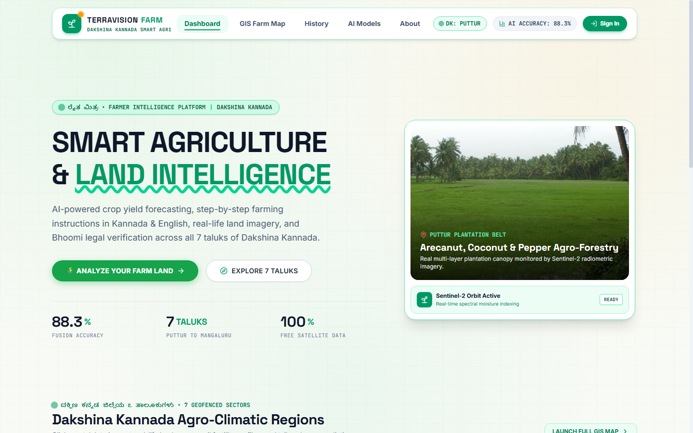

---

### 2. 🗺️ 7 Geofenced Taluk Agricultural Belts
Explore dedicated agro-climatic cards for Puttur, Mangaluru, Bantwal, Belthangady, Sullia, Moodbidri, and Kadaba with authentic landscape photography, Kannada descriptions, and primary crops.
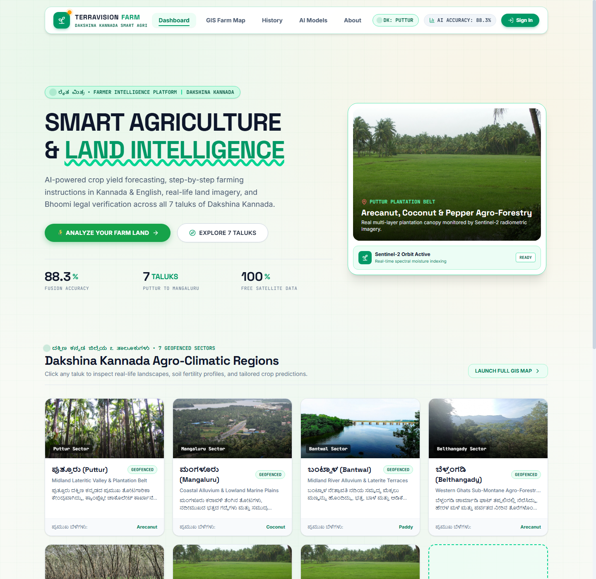

---

### 3. 🛰️ High-Precision GIS Satellite Farm Parcel Picker
Farmers can search any village/taluk, drop pins, or draw field boundary polygons to compute exact acreage (`Turf.js`), select map layers (Hybrid, Satellite, Street, Terrain), and trigger model inference.
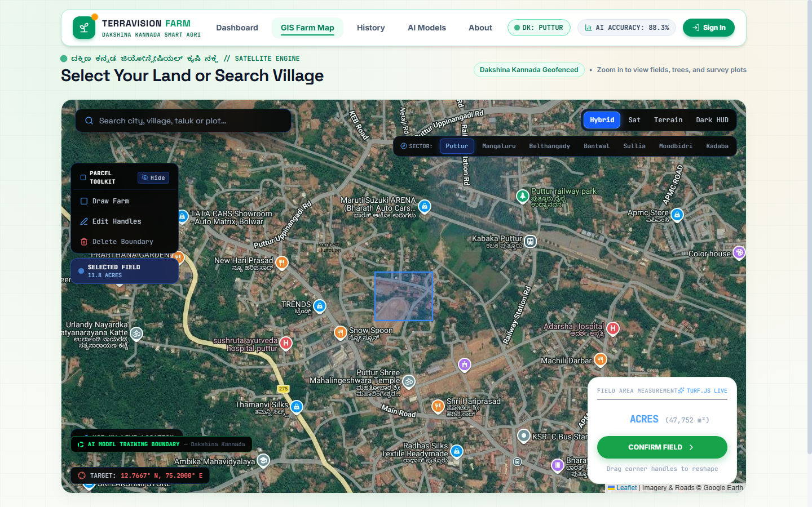

---

### 4. 🌾 Multi-Modal Crop Forecast & Yield Prediction
After prediction, view the primary recommended crop with authentic verified produce photography, real-time animated yield forecasting (Tonnes/Ha & Quintals/Acre), total farm production, and estimated market revenue in INR (₹).
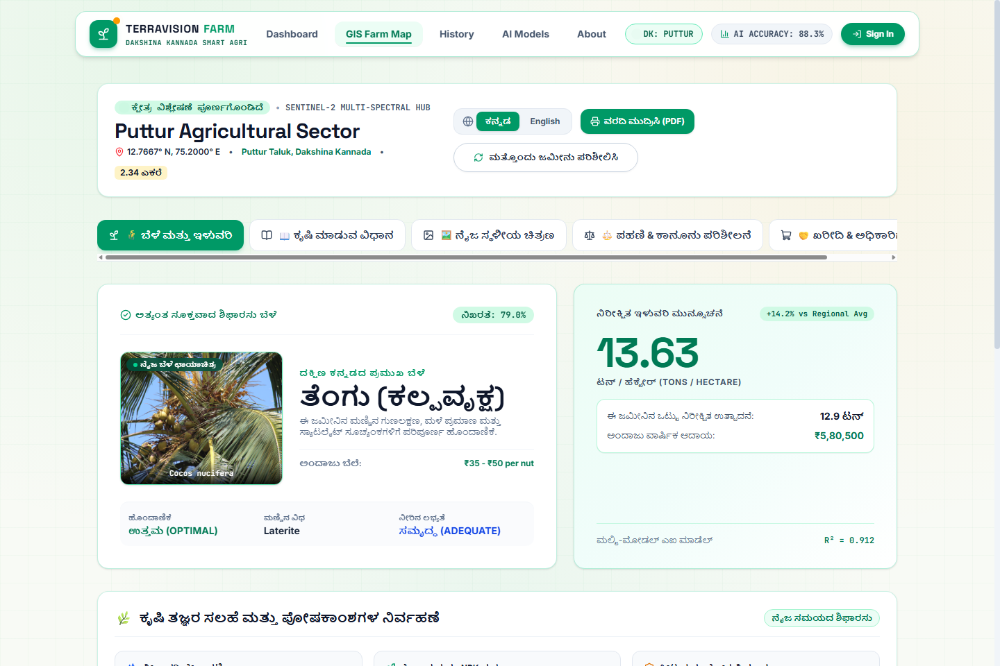

---

### 5. 📊 Crop Probability Matrix & Verified Legitimate Field View
Compare candidate crop suitability scores with photo thumbnails (Coconut, Groundnut, Pepper, Cashew) alongside the authentic farm field photo and Sentinel-2 spectral indices (NDVI, NDWI).
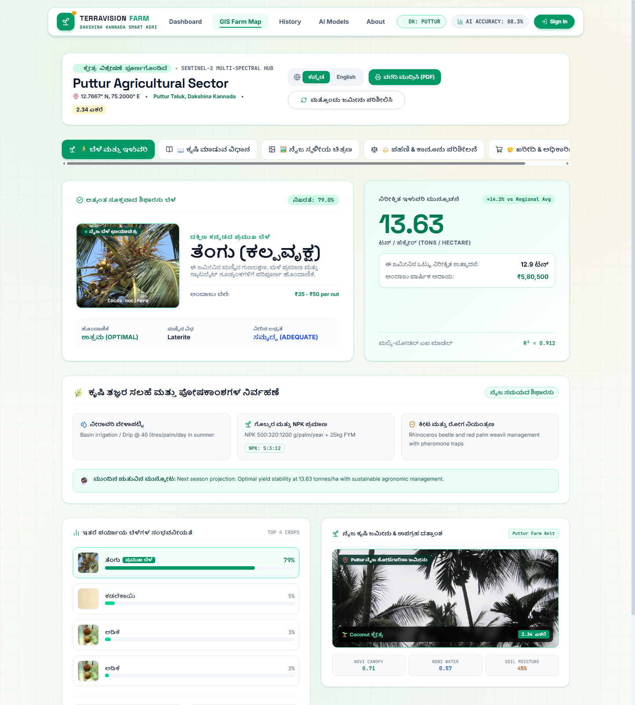

---

### 6. 📖 Step-by-Step Cultivation Guide (Bilingual: ಕನ್ನಡ & English)
A 6-phase agricultural guide covering Land Preparation & Pit Layout, Sapling Selection, Drip Irrigation, NPK Fertilizer Dosing, Bordeaux Spray Pest Control, and Harvesting/Curing, complete with a 3-stage visual gallery.
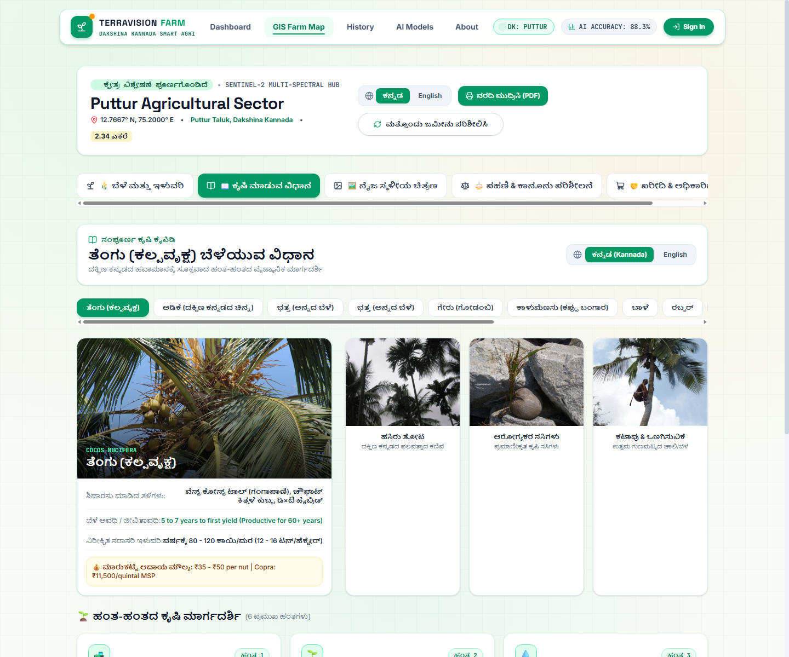

---

### 7. 🖼️ Real Regional Landscape & Climate Matrix
Displays the authentic landscape photography for the selected taluk, along with annual precipitation (3,800–4,200 mm), deep red lateritic soil profile (pH 5.2–6.2), Netravati/Kumaradhara water sources, and proven regional crops.
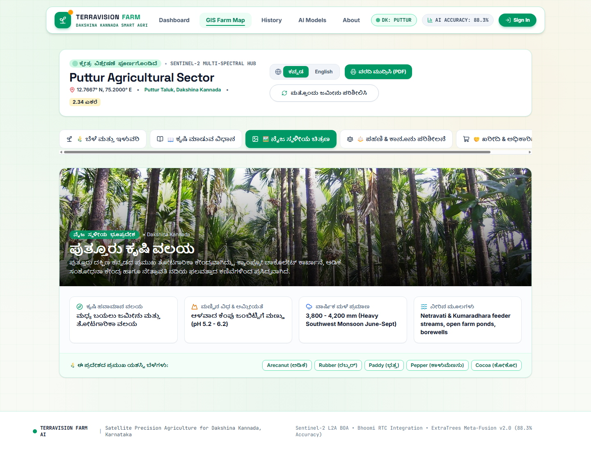

---

### 8. ⚖️ Land Legal & Bhoomi RTC (Pahani) Verification Checklist
Guidance for verifying Bhoomi RTC Column 9 (Kabjedar / Ownership), Column 11 (Liabilities / Bank Hypothecation), and Column 12 (Tenancy & Crops), plus Kaveri 2.0 EC Form 15/16, Mojini 11E survey sketches, and Kharab classifications.
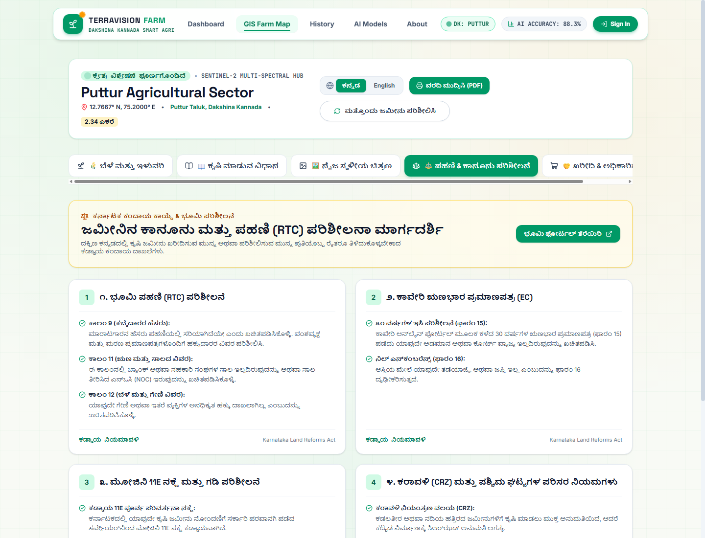

---

### 9. 🤝 How to Buy Land & Local Administrative Contacts
A 5-stage land purchase workflow (Title Search ➔ Mojini 11E Survey ➔ Sale Agreement ➔ Sub-Registrar Deed ➔ Automatic Bhoomi Mutation), accompanied by official contact phone numbers for Tahsildars, Sub-Registrars, and RSK centers.
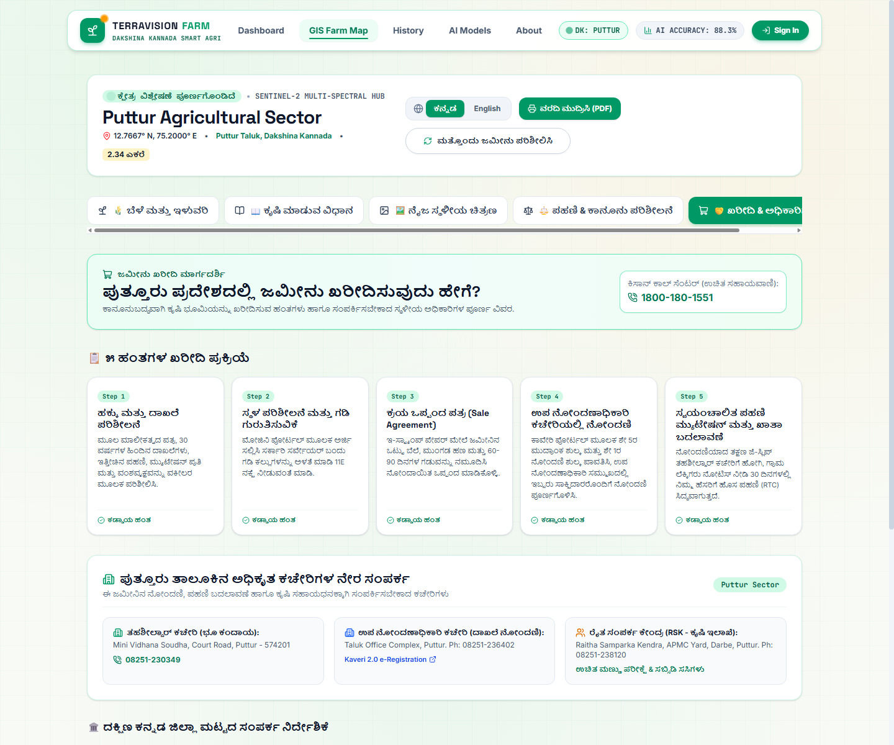

---

### 10. 🧠 Dual-Stream Meta-Fusion Model Architecture
Detailed architectural diagram of Stream A (Tabular XGBoost), Stream B (Spectral Random Forest), and the Meta-Learner (ExtraTrees v2.0), featuring weighted F1-scores, accuracy deltas, and live training benchmarks.
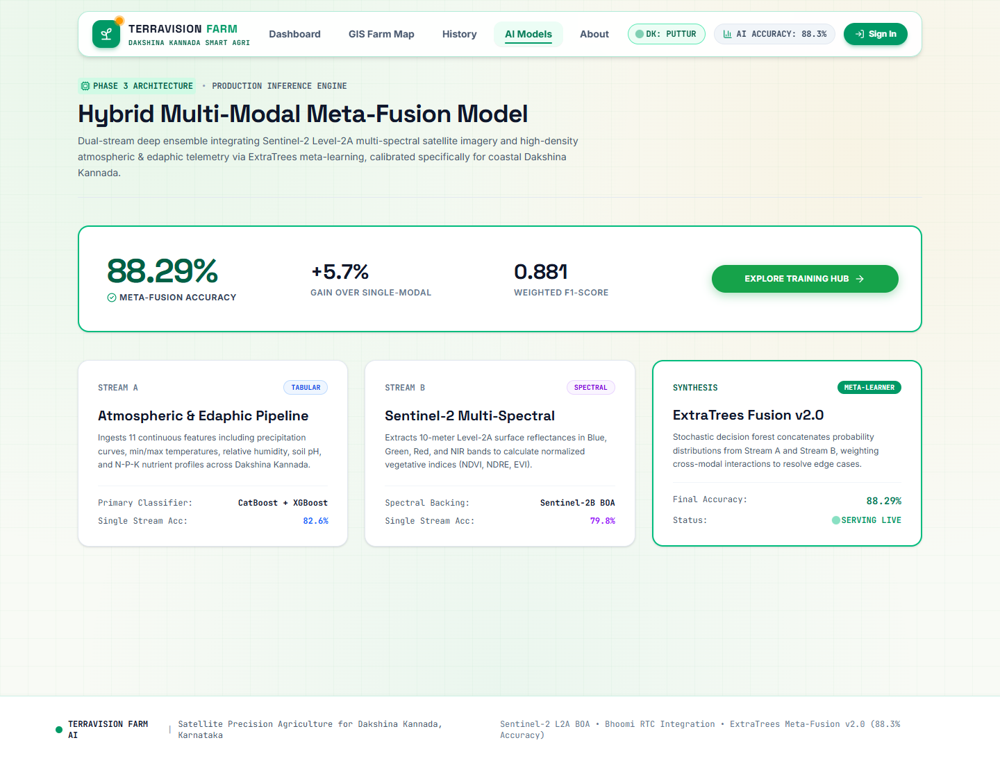

---

### 11. 📜 Historical Predictions Log
Tracks past field analyses, coordinates, crop recommendations, and forecasted tonnages with one-click reload capabilities.
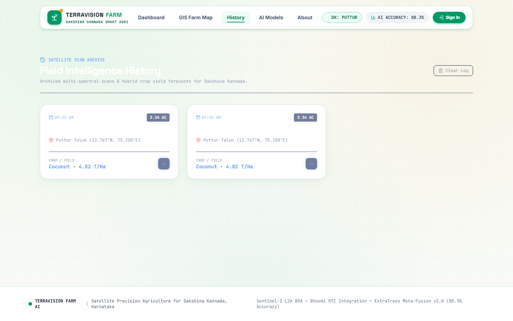

---

### 12. 🛰️ Multi-Spectral Sentinel-2 Technology & Mission
Technical documentation on ESA Sentinel-2 Level-2A Bottom-of-Atmosphere (BOA) reflectance bands, radiometric normalization, and scientific validation for coastal Karnataka horticulture.
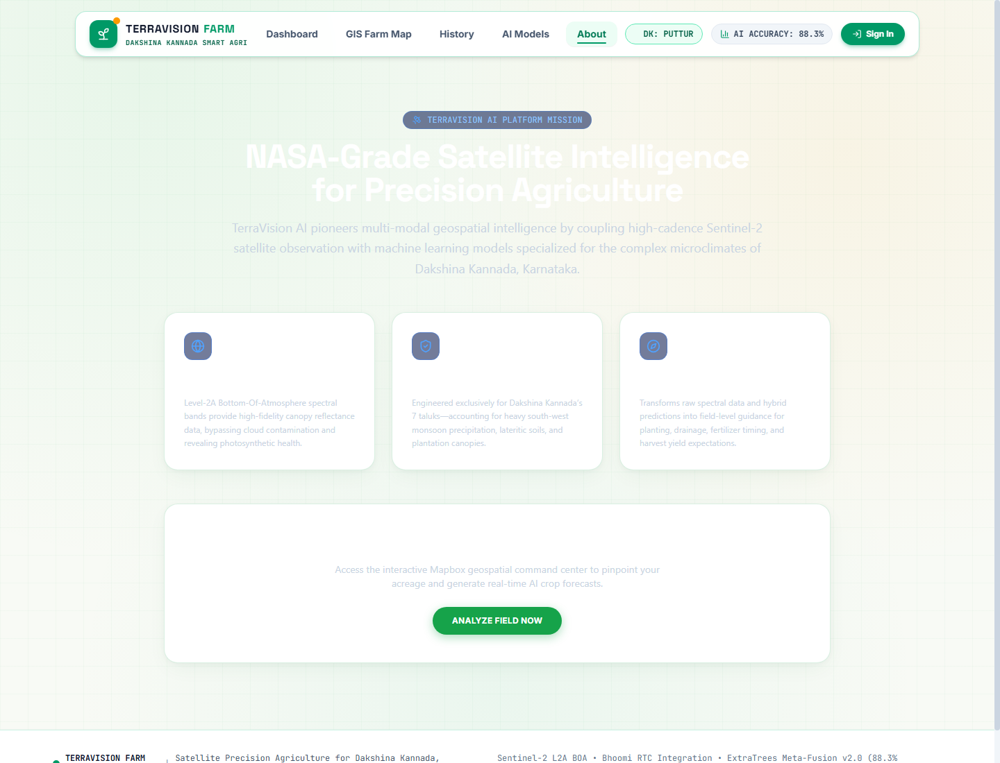

---

### 13. 🔐 Farmer Authentication Portal (Login / Registration)
Fast and secure authentication modal supporting local SQLite farmer profiles, session persistence, and custom farm parcel bookmarks.


---

## 🏗️ Technical Architecture

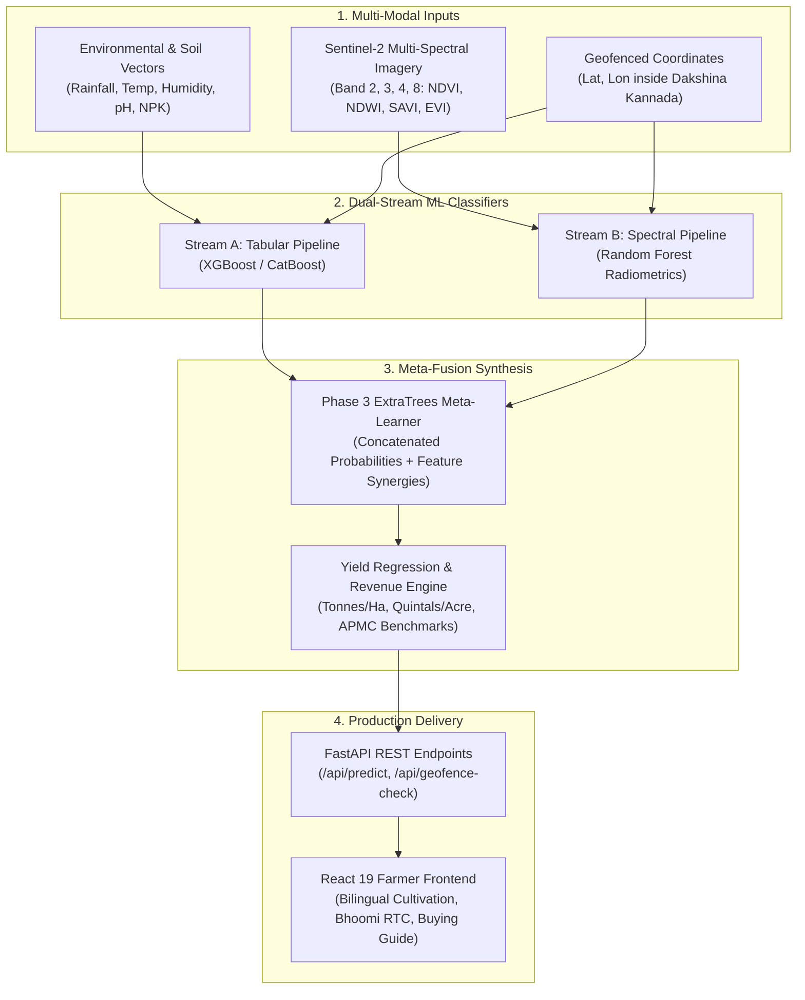

---

## 📂 Repository Structure

```
TerravisionFarm/
│
├── start.bat                         # ⚡ One-click launcher for Windows (Backend + Frontend)
├── start.ps1                         # ⚡ PowerShell launcher script
├── README.md                         # 📖 Project Documentation (with UI screenshots)
├── .gitignore                        # 🚫 Clean git exclusion rules
│
├── backend/                          # 🐍 FastAPI Backend Engine
│   ├── requirements.txt              # Python dependencies (FastAPI, Scikit-learn, XGBoost)
│   ├── data/
│   │   └── users.db                  # SQLite database for farmer authentication
│   └── app/
│       ├── main.py                   # FastAPI app entry point & CORS configuration
│       ├── core/
│       │   └── config.py             # Settings, paths & geofence parameters
│       ├── schemas/
│       │   ├── prediction.py         # Pydantic v2 schemas for inference requests & responses
│       │   └── auth.py               # Authentication request/response schemas
│       ├── services/
│       │   ├── model_service.py      # Production HybridPredictorEngine (Phase 1, 2, 3)
│       │   ├── agronomy_service.py   # Crop agronomic advice, NPK ratios & harvest cycles
│       │   ├── climate_satellite_service.py # Sentinel-2 radiometric indices extraction
│       │   ├── geofence_service.py   # Dakshina Kannada district boundary enforcement
│       │   ├── geocoding_service.py  # Local universal place names & reverse geocoding
│       │   └── auth_service.py       # Password hashing & user management
│       └── api/
│           ├── routes.py             # Prediction, geofence, metrics & plot endpoints
│           ├── auth_routes.py        # /auth/signup, /auth/login, /auth/me
│           └── gis_routes.py         # GeoJSON boundaries & administrative taluks
│
├── frontend/                         # ⚛️ React 19 + Vite Frontend
│   ├── package.json                  # React 19, Tailwind CSS v4, Leaflet, Lucide React
│   ├── vite.config.js                # Vite build config with backend proxy on :8000
│   ├── public/
│   │   └── images/
│   │       ├── crops/                # 🌾 Authentic crop photos (Arecanut, Coconut, Paddy, etc.)
│   │       └── fields/               # 🏞️ Authentic taluk fields (Puttur, Mangaluru, etc.)
│   └── src/
│       ├── App.jsx                   # Master dashboard state, tab routing & predictions
│       ├── index.css                 # Sunlight farm aesthetic, high-contrast typography
│       ├── data/
│       │   └── agriculturalData.js   # Regional profiles, cultivation steps & legal guides
│       └── components/
│           ├── Navbar.jsx            # Daylight glass navigation header with language & auth
│           ├── HeroSection.jsx       # Sunlit plantation banner with authentic imagery
│           ├── DashboardView.jsx     # 7 Taluk sector cards with Kannada titles
│           ├── HighPrecisionFarmPicker.jsx # Leaflet GIS satellite parcel picker
│           ├── ResultsView.jsx       # 5-tab post-prediction farmer dossier
│           ├── CultivationGuide.jsx  # Bilingual step-by-step agricultural instructions
│           ├── RegionalLandscapeCard.jsx # Scenic taluk photos & agro-climatic matrix
│           ├── LandLegalGuide.jsx    # Bhoomi RTC Columns 9/11/12 & Kaveri EC checklist
│           ├── LandBuyingGuide.jsx   # 5-stage purchase workflow & local office directory
│           ├── ModelsView.jsx        # Dual-stream AI architecture & accuracy showcase
│           ├── HistoryView.jsx       # Farm prediction logs
│           ├── AboutView.jsx         # Sentinel-2 mission & project vision
│           └── AuthModal.jsx         # Farmer login & registration modal
│
├── Model Zip/                        # 🧠 Serialized AI Artifacts
│   └── phase3_artifacts_v2.0/
│       └── phase3_artifacts_v2.0/
│           ├── models/
│           │   ├── phase1_tabular_model.pkl      # Trained XGBoost/CatBoost model
│           │   ├── phase2_satellite_model.pkl    # Trained Spectral Random Forest
│           │   ├── phase3_best_fusion_model.pkl  # Trained ExtraTrees Meta-Fusion
│           │   └── phase3_metadata.pkl           # Label encoders & classes
│           └── plots/                            # Confusion matrices, ROC & metrics
│
└── docs/
    └── screenshots/                  # 📸 Full-resolution UI screenshots for documentation
```

---

## 🚀 Quickstart & Installation

### Prerequisites
* **Python**: 3.10 or higher
* **Node.js**: 18.0 or higher
* **Git**: Installed and configured

---

### Option A: One-Click Launch (Windows)

Simply double-click `start.bat` in the root folder, or execute the PowerShell launcher:
```powershell
.\start.ps1
```
This automatically spins up:
* **FastAPI Backend**: `http://127.0.0.1:8000` (API Docs: `http://127.0.0.1:8000/docs`)
* **Vite React Frontend**: `http://127.0.0.1:5173`

---

### Option B: Manual Setup

#### 1. Setup Backend
```bash
# Navigate to backend directory
cd backend

# Create virtual environment
python -m venv venv

# Activate virtual environment
# Windows PowerShell:
.\venv\Scripts\Activate.ps1
# Windows CMD:
venv\Scripts\activate.bat
# Linux / macOS:
source venv/bin/activate

# Install dependencies
pip install -r requirements.txt

# Start FastAPI development server
python -m uvicorn app.main:app --host 127.0.0.1 --port 8000 --reload
```

#### 2. Setup Frontend
```bash
# Navigate to frontend directory in a separate terminal
cd frontend

# Install Node modules
npm install

# Start Vite dev server
npm run dev -- --port 5173
```
Open **[http://localhost:5173](http://localhost:5173)** in your browser.

---

## 📡 REST API Reference

| Method | Endpoint | Description |
| :--- | :--- | :--- |
| `POST` | `/api/predict` | Runs 3-phase multi-modal crop forecast for parcel coordinates |
| `GET` | `/api/geofence-check` | Verifies whether a latitude/longitude falls within Dakshina Kannada |
| `GET` | `/api/taluks` | Returns administrative profiles and coordinates for all 7 taluks |
| `GET` | `/api/metrics` | Fetches model accuracy, F1-scores, and performance breakdowns |
| `POST` | `/api/auth/signup` | Registers a new farmer profile in the local SQLite database |
| `POST` | `/api/auth/login` | Authenticates farmer credentials and returns a session payload |
| `GET` | `/api/auth/me` | Validates session token and returns active farmer details |

Interactive Swagger documentation is available at **[http://localhost:8000/docs](http://localhost:8000/docs)**.

---

## ⚖️ Land Legal Due Diligence Reference
Farmers and prospective buyers in coastal Karnataka must adhere to the statutory guidelines detailed inside the platform:
1. **Karnataka Land Reforms Act (Section 79A/B amendments)**: Non-agriculturist restrictions eased; land ceiling limits enforced.
2. **Column 9, 11, 12 Verification (Bhoomi Pahani)**: Confirm sole ownership, check absence of bank mortgage encumbrance, and verify nil tenancy claims under Form 7.
3. **Mojini 11E Pre-Mutation Sketch**: Mandatory boundary demarcation by licensed government surveyors before registration.
4. **Kharab Classification**: Distinction between cultivable **A-Kharab** and non-alienable government **B-Kharab**.
5. **Kaveri 2.0 Encumbrance Search**: Form 15 (recorded transactions) and Form 16 (nil-encumbrance) spanning a 30-year window.

---

## 👥 Authors & Acknowledgements
* **Author / Developer**: [Brijesh Vishwakarma](https://github.com/Brijesh2005)
* **Repository**: [https://github.com/Brijesh2005/CropAI](https://github.com/Brijesh2005/CropAI)
* **Domain Guidance**: ICAR Central Plantation Crops Research Institute (CPCRI Kasaragod / Vittal Regional Station)
* **Satellite Data**: European Space Agency (ESA Copernicus Sentinel-2 Multi-Spectral Imagery)
* **Land Portal Integration**: Karnataka Revenue Department (Bhoomi & Kaveri Online Systems)

---

*Made with ❤️ for the farmers and agriculture of Dakshina Kannada, Karnataka.*
